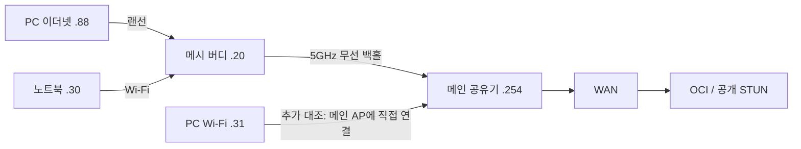

# 극저지연 검증 070 — 실제 연결 구조와 독립 경로 대조

작성: 2026-10-22. 분기: `codex/extreme-latency`. 원본은 Git 제외 `native/.local/extreme-070/`에 보존한다. 현재 조사는 진행 중이며 특정 펌웨어·무선 기능을 원인으로 확정하지 않았다.

## 먼저 바로잡은 전제

PC의 이더넷은 메인 공유기가 아니라 메시 버디에 연결되어 있었다. 사용자 배선 확인, PC MAC과 공유기 DHCP·단말 표의 대응, 실제 무선 BSSID로 확인했다. PC의 별도 Wi-Fi도 처음에는 같은 버디에 연결되어 있었다. 따라서 이전의 ‘유선 PC’ 시험은 PC→버디의 첫 구간만 유선이며 메시 무선 백홀을 배제한 대조가 아니다.

메인 공유기는 Davolink DV02-012H, 펌웨어 1.0.18이다. 읽기 당시 5GHz 채널 161/80MHz, 메시 백홀 신호 약 -65dBm이었다. 이 신호 값만으로 재전송·혼잡·스캔을 원인으로 지목하지 않는다. 메인 WAN/LAN의 1Gbps 링크 표시는 무선 백홀의 지연을 보증하지 않는다.

069의 노트북 게이트웨이 ICMP는 실제 통화 경로와 달랐다. `Find-NetRoute`에서 .254는 Tailscale, 1.1.1.1은 Wi-Fi였다. 409ms를 물리 공유기 응답으로 사용하지 않는다. 이후 PC 내부 대조는 대상별 이더넷 경로를 확인했고 UDP는 소스 주소 및 `IP_UNICAST_IF`를 지정했다.

## 방법

`PathIsolationProbe`에 오디오·코덱·WebRTC 없는 합성 LAN echo, 자체 OCI STUN Binding, 기존 공개 STUN 대조를 추가했다. 낮은 빈도 대조는 `Task.Delay(20)` 뒤 다음 질의를 보내 실제 약 32~34회/초였다. 요청한 20ms를 실제 송신 간격으로 오인하지 않는다.

선택 부하는 자체 OCI 또는 LAN에만 최대 400회/초를 요청하며 실제 약 326~343회/초였다. 고해상도 대기 타이머를 쓰고 전역 타이머 해상도는 바꾸지 않는다. 시험마다 2~150초, 서버 캡처는 최대 180초·300,000패킷·128바이트로 제한했다. 공개 STUN에는 부하 스트림을 보내지 않는다.

서버 pcap의 STUN transaction ID를 클라이언트의 무작위 토큰·순번에 맞춰 서버 처리와 전후 상대 변동을 구분한다. 호스트 간 절대 시각을 빼지 않으며 상대 변동은 절대 편도 지연이 아니다. 069 서버의 wall/monotonic offset 변화 범위는 약 0.0012ms여서 해당 시험의 수십 ms 변동을 시계 보정만으로 설명할 수 없었다.

## 음성 동반 시험 B: 앱 이전 경계의 변동

같은 DLL·2.5ms Opus·5~20ms 적응 예비량으로 120초 TURN 통화와 135초 독립 경로 대조를 실행했다. 노트북에서 자체 NIC 캡처를 함께 수집했다. ETL 5,754,799바이트, ETW 손실 0, 서버 218,477패킷·커널 드롭 0이었다.

노트북 RTP 12,072건은 서버 양쪽 경계에 모두 대응했다. 서버 체류 P95 0.272ms, 최대 3.935ms였다. 가장 큰 보존 수신 간격 60.007ms의 동일 경계 패킷은 서버 발신 간격 9.347ms, NIC indication 간격 60.096ms였다. 해당 쌍의 간격 증가는 대부분 서버 발신 소프트웨어 캡처→NIC indication 사이에 있었다.

RTP NIC 대응은 90.87%로 불완전하다. 따라서 중간 패킷 전체의 부재나 모든 사건의 동일 원인을 확정하지 않는다. 대응된 패킷의 NIC→앱 최대는 1.944ms였다.

같은 호스트 QPC 553654.25~553655.30 구간의 독립 대조는 다음과 같다.

| 응답 경로 | RTT 최대 | 해당 구간 NIC→앱 최대 | NIC 대응 수 |
|---|---:|---:|---:|
| LAN echo | 12.42ms | 0.354ms | 33/33 |
| OCI STUN | 73.78ms | 0.369ms | 32/33 |
| 공개 STUN | 106.12ms | 0.445ms | 31/33 |

같은 시각 서로 다른 서버 경로가 늦어졌으며 대응된 수신에서 큰 앱 전달 지연은 관측되지 않았다. 하지만 이 시점 두 PC 모두 버디 경유였으므로 이를 WAN만의 문제로 한정하지 않는다.

## 앱 없는 부하·경로 대조

- A: 두 PC 120초 저빈도 대조. OCI RTT 최대 PC 31.51ms·노트북 35.19ms. 큰 200ms 사건은 재현되지 않았다.
- C: OCI 부하→LAN 부하→OCI 부하 각 45초. PC의 LAN 부하 응답이 0이어서 B단계는 유효한 인과 대조에서 제외한다. 서로 다른 프로세스의 시작·종료 불일치도 있어 LAN의 처음/끝 미응답을 손실률로 계산하지 않는다. 이 시험으로 패킷 빈도가 원인이라고 판정하지 않았다.
- D: 노트북 시험 없이 PC 이더넷만 150초. OCI RTT 최대 106.36ms, 공개 STUN 137.58ms, 부하 112.45ms. 이더넷 역시 버디 경유이므로 무선 전체를 제거한 시험은 아니다. 어댑터 바이트 카운터 구간 최대는 수신 약 8.31Mbps·송신 5.99Mbps였으며 다른 가정 내 기기의 사용량을 뜻하지 않는다.
- E: 버디 .20·메인 .254·루프백 ICMP와 외부 UDP 동시 150초. ICMP 최대 2/9/0ms. 외부 UDP 최대 45.19ms였다. ICMP 실제 빈도가 낮아 짧은 공백을 놓칠 수 있고 미디어와 우선순위도 달라 무선 경로를 배제하지 않는다.
- F: 이더넷에서 게이트웨이 DNS와 외부 UDP 동시 대조. DNS 4,803건 응답, 최대 17.48ms. 모든 응답은 localhost의 NXDOMAIN이었다. 외부 전달 여부를 패킷 내용만으로 확정하지 않는다.

## 메인 AP 우회 대조 G

사용자가 PC Wi-Fi를 메인 공유기의 5GHz SSID로 연결했다. PC BSSID와 메인 공유기의 무선 단말 표에서 직접 연결을 확인했다. 버디 이더넷 .88과 메인 Wi-Fi .31을 같은 PC에서 동시에 150초 측정했다. 두 NIC의 실제 바이트 증가도 확인했다. 서버 218,884패킷·드롭 0이었다.

| 경로 | OCI RTT 중앙값 / P95 / 최대 | 공개 STUN 최대 | 부하 RTT 최대 |
|---|---:|---:|---:|
| 이더넷→버디→5GHz 백홀 | 10.29 / 13.46 / 56.16ms | 75.78ms | 66.99ms |
| 메인 AP에 직접 5GHz Wi-Fi | 10.05 / 13.16 / 57.22ms | 83.33ms | 68.13ms |

메시를 우회해도 같은 크기의 변동이 남았다. **메시 백홀만을 단독 원인으로 확정하지 않는다.** 두 경로는 메인 공유기와 같은 5GHz 채널을 여전히 공유한다.

## 메인 5GHz 직접 경로 H

독립 Python 프로세스의 게이트웨이 DNS·OCI TCP443 연결 대조와 .NET UDP 대조를 같은 PC QPC로 연결했다. 150초이며 오디오·코덱·WebRTC는 없다.

| 대조 | 표본 수 | 최대 RTT |
|---|---:|---:|
| 게이트웨이 localhost DNS | 4,824 | 119.05ms |
| OCI TCP 연결 | 1,237 | 150.96ms |
| OCI STUN | 별도 원본 참조 | 159.42ms |
| 공개 STUN | 별도 원본 참조 | 171.56ms |

대표 QPC 95254.322 부근에서 OCI UDP는 126.23ms로 늘었고 같은 호스트 내부 echo는 0.18ms였다. 다음 UDP는 105.52ms였지만 내부 echo는 0.17ms였다. 별도 Python DNS도 약 95.5ms부터 63.9/32.8ms로 내려가는 응답 묶음을 기록했다. 특정 .NET 진단 프로세스의 정지나 Opus만의 문제로 설명하기 어렵다.

DNS 응답 처리와 실제 미디어 전달은 동일하지 않다. 이 결과로 AP 스캔·전원·재전송·공유기 CPU 중 하나를 확정하지 않는다. DNS의 로컬 처리 자체를 더 분명히 할 비재귀 CHAOS TXT 질의는 게이트웨이에서 NOTIMP(4), 질문만 되돌린 30바이트 응답이 약 1~3ms에 반환됨을 사전 확인했다.

## 현재 남은 대조와 변경 범위

I에서 사용자가 메인 AP 2.4GHz(채널 5, BSSID 직접 확인)로 연결한 뒤 기존 5GHz 메시 경로와 150초 동시에 비교했다. 게이트웨이 UDP는 재귀를 요청하지 않은 CHAOS TXT에 대한 NOTIMP(4) 응답이며 모든 응답 코드를 보존했다.

| 경로 | OCI RTT 중앙값 / P95 / 최대 | 게이트웨이 UDP 최대 | OCI 서버 처리 최대 |
|---|---:|---:|---:|
| 버디 경유 이더넷·5GHz 백홀 | 9.92 / 13.11 / 39.45ms | 23.60ms | 3.81ms |
| 메인 AP 직접 2.4GHz Wi-Fi | 60.35 / 113.22 / 441.87ms | 347.91ms | 5.28ms |

서버 220,034패킷·커널 드롭 0, 양쪽 OCI 대조 4,816건 모두 서버 양 경계 대응이었다. 2.4GHz의 서버 이전 상대 변동 중앙값은 약 37.43ms, 서버 이후 최대는 약 358.83ms였다. 루프백 최대는 약 8ms였다. 동일 시간대·서버·PC의 두 경로가 다르므로 이 큰 2.4GHz 변동은 외부 회선이나 Opus만으로 설명되지 않는다. 기존 5GHz의 모든 순간 사건을 같은 원인으로 확정한 것은 아니다.

J에서는 2.4GHz에서 WLAN 백그라운드 스캔 허용만 A/B/A로 각 45초 바꾸었다. 첫 5초·끝 2초를 제외한 OCI RTT 중앙값은 56.78 / 58.39 / 58.07ms, 게이트웨이 UDP 중앙값은 41.59 / 42.12 / 41.99ms였다. API가 스캔 플래그 1→0을 확인했지만 이 지속 지연은 줄지 않았다. 각 핸들 해제 뒤 스캔 1·스트리밍 0으로 원상 복구했고 API 오류는 없었다. 실제 모든 드라이버 내부 스캔이 계측되거나 금지됐다고 주장하지 않는다.

K에서는 미디어 스트리밍 모드만 독립 A/B/A 대조했다. OCI RTT 중앙값은 62.15 / 59.36 / 58.31ms, 게이트웨이 UDP 중앙값은 42.52 / 41.09 / 41.70ms로 지속 지연 개선이 없었다. API 요청·해제는 모두 성공했고 원래 값으로 복구됐다. [Microsoft의 WLAN opcode 문서](https://learn.microsoft.com/en-us/windows/win32/api/wlanapi/ne-wlanapi-wlan_intf_opcode)에 따른 클라이언트 핸들 범위 요청이며 보안·프로필·전역 전원 정책을 변경하지 않는다. 서비스의 요청 값 반영과 실제 무선 하드웨어 동작은 구분한다. [연결 품질 힌트](https://learn.microsoft.com/en-us/windows-hardware/drivers/ddi/dot11wificxtypes/ne-dot11wificxtypes-wdi_connection_quality_hint)는 드라이버 동작의 계약이며 이번 기기의 준수를 증명하는 측정값은 아니다.

Realtek WLAN 통계 조회는 활성 Wi-Fi에서도 PHY 송신·재시도·ACK 실패 카운터가 모두 0이었고 MAC 송신도 0이었다. 읽기 API 성공을 재시도 없음으로 해석하지 않으며 인과 판단에서 제외했다. AC 무선 전원 정책은 이미 최대 성능이었다. 설정 정책만으로 실제 NIC 전원 상태를 판단하지 않는다.

공유기 로그인은 사용자가 직접 수행했고 관리 화면은 읽기 전용으로 사용했다. 공유기 채널·모드·보안·전원 설정, 시스템 라우팅, 음성 버퍼·알고리즘은 변경하지 않았다. 사용자가 PC Wi-Fi 연결을 시험용으로 변경했다. 배포본 교체와 Git 커밋·푸시는 하지 않았다.

`verify.ps1 -NoRestore -Integration`의 Release 빌드(경고/오류 0), 정적 분석·회귀·서버 8개 및 네이티브 ICE/DTLS/SRTP/RTCP 통합 검증이 통과했다. 기존 패킷 분석기 4종 자체 검증과 `git diff --check`도 통과했다. 이 검증은 네트워크 최종 원인을 확정하거나 안정판 승격을 뜻하지 않는다.

## L: 음성 QoS 요청의 실효성 대조

2.4GHz 직접 경로에서 기본→qWAVE Voice→기본을 각 45초 대조했다. 첫 5초·끝 2초를 제외한 값이다. 별도 Python 게이트웨이 UDP와 버디 경유 이더넷 대조를 함께 유지했다.

| 구간 | OCI RTT 중앙값 / P95 / 최대 | 게이트웨이 UDP 중앙값 / P95 |
|---|---:|---:|
| A1 기본 | 61.00 / 110.29 / 247.38ms | 45.09 / 95.50ms |
| B Voice 요청 | 61.55 / 108.49 / 226.22ms | 42.98 / 94.89ms |
| A2 기본 | 61.63 / 109.90 / 244.37ms | 45.37 / 95.22ms |

qWAVE 생성·3개 흐름 추가·해제는 성공했다. 하지만 OCI에서 관찰한 요청과 응답의 DSCP는 세 구간 모두 0이었다. A1/B/A2 각 16,526 / 16,532 / 16,542개의 요청·응답이 대응했다. 서버 캡처 209,472패킷·커널 드롭 0. 이는 이 경로에서 음성 표시가 끝까지 유지됐다는 증거가 없다는 뜻이며, PC 송신 시점부터 0이었는지 중간에서 재표시됐는지는 서버 캡처만으로 구분하지 못한다. 사전 2초 시험의 낮은 중앙값은 장기 대조에서 재현되지 않아 개선 근거에서 제외했다.

[Microsoft qWAVE 문서](https://learn.microsoft.com/en-us/windows/win32/api/qos2/ne-qos2-qos_traffic_type)의 Voice 및 NON_ADAPTIVE_FLOW 요청만 사용했다. [Mumble 소스](https://github.com/mumble-voip/mumble/blob/master/src/mumble/ServerHandler.cpp)도 같은 계열 API를 사용하지만, 이 사실만으로 본 환경의 효과를 가정하지 않았다. 진단 실행에만 추가했으며 음성 앱의 기본 동작에는 적용하지 않았다.

## M: 지속 트래픽으로 무선 대기 해소 여부

같은 2.4GHz 경로에서 기본→지속 다운로드→기본을 각 45초 대조했다. 다운로드는 별도 SSH 연결을 Python 프록시의 명시적 source/IP_UNICAST_IF=20으로 연결해 50초·262,144바이트/초로 제한했고 종료 코드 0이었다. 약 2Mbps 트래픽은 진단 대조이며 제품의 유지 트래픽으로 채택하지 않는다.

첫 5초·끝 2초를 제외한 OCI RTT 중앙값은 62.09 / 66.47 / 62.07ms, P95는 113.41 / 165.59 / 126.70ms였다. 게이트웨이 UDP 중앙값은 45.90 / 46.44 / 43.26ms였다. 로컬 자체 echo 최대는 각 0.55 / 0.68 / 0.50ms였다. 지속 다운로드가 지연을 해소하지 않았으며, B에서 상위 지연은 오히려 컸다. 이를 절전 원인의 반증으로 단정하지는 않는다. '트래픽이 적어서 잠든다'는 단순 설명과 트래픽 추가 완화책의 근거가 되지 않는 결과다.

서버 캡처는 209,286패킷·커널 드롭 0이었다. 다운로드는 암호화된 SSH이며 서버 캡처 필터는 이전과 동일한 합성 STUN UDP만 수집했다. 무선 드라이버·AP 사이의 전력 상태, 무선 재전송 및 802.11 스케줄링은 이 캡처로 직접 관측하지 않았다.

## P: 무선 모드 변경을 포함한 어댑터 재초기화

관리자 프로세스에서 진단 실행 파일의 상대 경로가 잘못 계산된 N/O 사전 시도는 설정 변경 전에 중단됐다. 원래 RegistryValue=45 유지가 확인됐으며 유효 대조로 취급하지 않는다. P에서는 절대 실행 경로로 바로잡았다.

동일 AP 2.4GHz·채널 5에서 AX 허용(45)→N 제한(13)→AX 허용(45), 각 35초를 비교했다. 각 변경 뒤 어댑터를 재시작했으므로 '모드'와 '어댑터 초기화'가 동시에 바뀐 대조다. 실제 연결이 802.11ax→802.11n→802.11ax로 바뀌고 BSSID가 같은 것을 확인했다. RSSI는 약 −53~−54dBm였다. 첫 5초·끝 2초를 제외했다.

| 구간 | OCI RTT 중앙값 / P95 / 최대 | 게이트웨이 UDP 중앙값 / P95 |
|---|---:|---:|
| A1 AX·초기화 전 | 62.93 / 120.96 / 226.77ms | 45.48 / 95.29ms |
| B N·초기화 후 | 9.78 / 19.64 / 43.76ms | 0.91 / 10.35ms |
| A2 AX·다시 초기화 후 | 10.50 / 18.82 / 45.80ms | 1.18 / 10.25ms |

**AX를 다시 허용해도 지연이 낮게 유지됐다. AX 자체가 이 지속 지연의 원인이라는 해석은 배제한다.** 무선 모드 변경을 포함한 어댑터 재초기화 이후 로컬 게이트웨이와 외부 경로 지연이 함께 회복된 사실은 확인했다. 재연결, 드라이버 상태 초기화, AP 연결 상태 재생성 중 무엇이 유효했는지는 이 대조 하나로 구분하지 못한다. 따라서 제품에서 임의로 AX를 끄거나 무선 장치를 재시작하는 동작을 추가하지 않는다.

원래 무선 드라이버 값 45, 원래 시험 AP 연결이 복구됐고 최종 오류는 없었다. 서버 캡처 186,820패킷·커널 드롭 0. 다음 Q에서는 모드를 바꾸지 않고 대역 간 재연결과 어댑터 재시작을 분리한다.

## Q/S: 대역 재연결과 재시작 분리

Q의 5GHz 연결 요청은 Windows의 가용 네트워크 목록에 해당 SSID가 없어 시작되지 않았다. 기준 구간만 유효하며 대역 전환 대조로 취급하지 않는다. 원래 2.4GHz 연결과 드라이버 값 45로 복구됐다. 별도 Native WLAN Scan 한 번(열기·검색·닫기 모두 API 0) 뒤 메인 5GHz 연결이 성립했고 BSSID를 확인했다. 저장 프로필이 있다는 사실만으로 즉시 연결할 수 있다고 가정하지 않았다.

S에서는 모드 45(AX 허용)를 유지한 채, 2.4GHz 기준→명시적 검색 후 5GHz에 실제 연결하고 2.4GHz 복귀→같은 모드에서 어댑터 재시작 순서로 각 35초를 비교했다. 두 AP의 실제 BSSID와 연결 방식을 확인했다. 첫 5초·끝 2초 제외 결과다.

| 구간 | OCI RTT 중앙값 / P95 / 최대 | 게이트웨이 UDP 중앙값 / P95 |
|---|---:|---:|
| A1 초기화 후 기준 | 10.29 / 16.60 / 38.65ms | 1.16 / 7.82ms |
| B 대역 왕복 재연결 후 | 10.76 / 22.99 / 53.15ms | 1.25 / 12.57ms |
| A2 같은 AX 모드 재시작 후 | 11.02 / 33.02 / 54.89ms | 1.29 / 12.07ms |

대역 전환만으로 이전의 지속 60ms 중앙값이 다시 생기지 않았다. 모드·프로필·연결이 최종 복구됐으며 오류는 없었다. P의 회복은 확인했지만 이전 상태의 생성 조건은 아직 재현하지 못했다. 재시작이 항상 필요한 해결책이라고 주장하지 않는다.

## AP 상태·보안 이벤트 추가 확인

사용자가 재로그인한 뒤 공유기 상태와 로그, 무선 관리 항목을 다시 읽었다. 2.4GHz는 20MHz·Auto 채널 5·b/g/n/ax, 인증은 WPA/WPA2 혼합·AES이며 Broadcast Key Update는 비활성이었다. 적용·단말 끊기·키 표시 버튼은 사용하지 않았다. 비밀번호를 읽거나 추출하지 않았다.

AP 단말 표의 PC 연결 경과 시간과 바이트 카운터가 반복해서 작아졌으며, 로그에도 인증 해제→재연결→DHCP ACK가 반복됐다. 같은 시간대 Windows WLAN 이벤트 11004→11010→11005도 반복돼 단순 표 카운터 갱신만으로 해석하지 않는다. 반면 8000/8001/8003만 조회하면 이 반복이 보이지 않았다. AP의 시간과 PC 시간이 같은 오프셋이라고 가정하지 않고 직접적인 지연 상관에는 같은 PC의 이벤트 시각을 사용한다.

이 보안 반복은 시험용 2.4GHz 경로에서 발견한 별도 현상이다. 기존 5GHz·메시 백홀의 모든 지연을 설명한다고 주장하지 않는다. 활성 합성 트래픽 중 반복이 유지되는지, 인증 방식과 함께 가역적으로 달라지는지 확인이 필요하다.

## V: 마지막으로 완료한 인증 방식 대조와 중단 상태

사용자 요청에 따라 V까지 완료하고 새 시험은 시작하지 않았다. PC 프로필만 WPA→WPA2→원래 WPA로 대조했다. 각 구간은 합성 Wi-Fi UDP 없는 45초와 활성 측정 40초이며, 활성 구간 첫 5초·끝 2초를 제외했다. 실제 WLAN 프로필 API 읽기와 연결 상태에서 WPA2-Personal 반영을 확인했다. AP 설정·AES·키는 변경하지 않았다.

| 구간 | OCI RTT 중앙값 / P95 / 최대 | 게이트웨이 UDP 중앙값 / P95 / 최대 |
|---|---:|---:|
| A1 WPA | 9.90 / 20.19 / 52.07ms | 1.12 / 11.99 / 52.03ms |
| B WPA2 | 10.59 / 17.61 / 40.45ms | 1.08 / 8.78 / 33.92ms |
| A2 WPA 복구 | 10.93 / 46.19 / 188.95ms | 1.38 / 42.15 / 220.42ms |

측정 구간 이벤트 수집 JSON은 모두 빈 배열이었다. 이전의 반복 보안 협상이 이 대조에서 가역적으로 재현됐다는 증거가 없으므로 WPA가 원인 또는 WPA2가 해결책이라고 판정하지 않는다. 이벤트 수집의 UTC 필터와 원본 이벤트 대조도 다음 인계 시 확인할 항목이다.

T는 프로필 변경 명령 종료가 비정상이어서 B 측정 전에 중단·복구했다. U 사전 검증에서 Windows netsh가 성공 문구와 실제 WPA2 반영 후 `0xC0000374`로 종료한 것을 확인했다. V는 명령 종료 코드를 별도로 보존하고 실제 WLAN API 읽기·연결 방식으로 반영을 검증했다. netsh 종료 문제는 앱 예외나 네트워크 지연 원인으로 섞지 않는다. 원래 프로필 복구 명령은 종료 코드 0, API 읽기에서도 WPAPSK/AES였다. 원시 XML과 키를 파일로 저장하거나 평문 키를 요청하지 않았다.

### 마지막 큰 지연의 같은 시각 대조

A2의 QPC 100367.632~100367.862에서 다음이 관측됐다.

- Wi-Fi OCI #833 RTT 188.952ms, 같은 반복의 자체 echo 0.187ms, 외부 기준 STUN 188.885ms.
- 별도 Python의 로컬 게이트웨이 UDP #839~844는 220.424 / 189.016 / 166.975 / 135.877 / 104.808 / 73.704ms로 묶여 도착했다.
- 같은 PC의 버디 경유 이더넷 OCI RTT는 해당 구간 7.81~12.46ms, 외부 기준 STUN은 36.93~40.45ms였다.
- OCI #833 서버 체류는 0.059ms였다. 서버 전·후 상대 변동은 각각 약 126.24 / 57.90ms로, 호스트 간 절대 시계를 뺀 단방향 지연은 아니다.

**이 사건은 PC의 2.4GHz 경로에 국한된 대기로 좁혀졌다.** 같은 PC·외부 목적지·WAN을 사용하는 이더넷 대조는 빨랐고, 인터넷을 거치지 않는 별도 프로세스의 게이트웨이 응답도 함께 늦었다. 모든 시스템 CPU 정지·특정 .NET 프로세스·Opus·OCI 처리만으로 설명하기 어렵다. PC 무선 드라이버/무선 매체/AP 해당 무선 경로의 내부 항목까지 구분한 것은 아니며, 과거 5GHz 공통 사건의 원인과 동일하다고 주장하지 않는다.

V 서버 캡처는 282,708패킷·커널 드롭 0으로 종료됐다. S는 205,510패킷 캡처·필터 수신 206,244·커널 드롭 0이었다. S의 수신 수와 파일 기록 수가 다르므로 전체 수신이 파일에 빠짐없이 남았다고 주장하지 않는다. P/S/V 각 세 구간 서버 분석 파일을 모두 생성했다.

### 종료 확인

- PC 프로필: 원래 WPAPSK/AES, useOneX=false.
- 드라이버: 2.4GHz 값 45, 5GHz 값 58 복구.
- PC Wi-Fi: 사용자가 이번 시험을 위해 선택한 메인 2.4GHz, 주소 .31. 이더넷 .88은 버디 연결 유지. 최초 메시 SSID로 임의 변경하지 않았다.
- V 최종 결과 restored=true, error=null. PC TransportProbe 및 OCI tcpdump 실행 없음 확인.
- 공유기 설정·음성 앱 기본값·배포본·Git 커밋/푸시 변경 없음. 공유기 관리 세션은 다시 만료돼 로그인 화면 상태다.
- 후속 공개 요약은 [현재 상태](../CURRENT-STATUS.md)를 참고한다. 개인 인계와 원본 재현 파일 위치는 Git 제외 로컬 자료로 보존한다.
